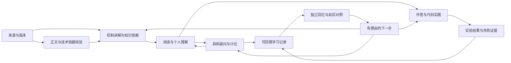

# SuGuilin 学习系统：对象、状态与产品约束

当前架构与本轮改动，2026-10-13。面向有Python/ML/LLM经验、需要长期深化与拓展的个人学习者。系统成果是能持续积累的理解、问题、作答与实践证据；页面数、链接数、阅读次数不认证能力。

## 系统主线

这不是强迫每次学习完成全部步骤。闲暇阅读、只记问题、暂不运行代码、中断复习均可保存并继续。来源未读、问题未解决、实验未执行与学习已掌握不是同一状态。

## 五个协作层

| 层 | 核心职责 | 当前实现与边界 |
| --- | --- | --- |
| 知识与来源 | 原文范围、版本、机制、前置与反例 | 30篇教材、显式前置/相邻关系、原资料及核验说明；资料条目不自动变成完整课程 |
| 个人学习记录 | 收藏、标注、问题、作答、实验、复习尝试 | 原始notes/studyProgress/conversations等对象，按专题ID与可信回链关联；保留历史和独立回忆 |
| 学习调度 | 时间预算、继续何事、推荐理由 | `learningContext`统一读取已有记录；`learningAction`统一延续动作；日队列使用原调度器，推荐使用原信号模型 |
| 阅读与操作 | 内容优先、连续入口、不中断输入 | 计划、推荐与阅读页读取同一专题上下文；记录变化只刷新只读链接，不重建正在输入的作答区域 |
| 持久化与服务 | 本机保存、恢复、导出、权限与模型 | 免费本机记录/JSON/Obsidian；既有Supabase保持部署未开通，官方会员网站通过复制上下文衔接；不宣称站内模型已实时回答 |

知识库、计划、阅读、日志、练习与面试是不同目的的视图。它们共享学习对象和状态，不各自复制一份“学习进度”。派生上下文不落库、不新增掌握度分数，导入旧备份即可重建。

## 统一的专题上下文

一个专题的上下文包括：保存的阅读位置、当前尝试、关联笔记与标注、未解疑问、实验记录、复习日期。严格按专题关联，不能把另一个专题或未关联的个人问题塞入当前课文。无记录时不显示一排0或空提示。

执行顺序：进行中的独立回忆→明确到期复习→待自检作答→关联未解疑问→继续阅读。推荐如果明确说“这个问题还待解答”，则直接打开那个问题的日志；推荐理由和目标必须一致。显式“阅读”“练习”等操作保持用户选择的意图。

已解决问题仍保留原文与讨论，可重新打开；解决后不再占未解疑问推荐。正在“待解答问题”筛选中标解决，去除不再匹配的类型筛选并保留当前笔记，避免操作后看不到自己刚更新的记录。计划中当前主动作已覆盖的任务，不在待处理列表重复出现。

记录变化时，阅读页显示关联日志、未解疑问、当前/上次作答、实验草稿/记录和复习日期；不是额外的大面板。当前回忆与旧答案分开计数，导入实验结果不代替作答或自评。

## 知识如何进入体系

来源→保留作者/时间/版本/读取范围→核对技术依据与观点条件→形成机制讲解/具体问题→原创练习与可执行实验→进入明确知识依赖→个人记录与复习。未取得正文的公众号/小红书等保留线索状态，不生成“已读要点”；最新发布日期、作者发布日期、核对日期、运行环境分别记录。

已有阅读、标注、练习、问题和报告仍是原数据；本轮没有修改共享状态格式、数据库、来源提炼器或推荐评分规则。知识深度、真实模型/GPU/服务实践、跨天学习效果仍按原文和实际实验验收，不能由统一导航推出已经完成。

## 参考模式与采用范围

- [Readwise标注与笔记](https://docs.readwise.io/reader/docs/faqs/highlights-tags-notes)：读官方公开说明，参考记录附原文、聚合后能回原上下文；不复制资产，也未体验付费账户。
- [Obsidian内部链接](https://help.obsidian.md/links)：官方入口，参考持久记录之间的可回溯连接；不将外部产品的同步能力当本站已启用。
- [Anki FSRS文档](https://docs.ankiweb.net/manual/deck-options)：读当前官方调度说明入口。本站仍使用明确的自评日期与独立尝试，不声称实现或验证了FSRS、记忆概率或最优学习效果。

## 本轮验收门槛

1. 同一专题的推荐、计划、阅读和日志能指向同一问题/作答/实验。
2. 推荐“未解疑问”确实打开原问题，不掉回普通正文；外专题问题不被错误关联。
3. 新复习只统计本次空白/已写作答，旧答案和实验仍可对照。
4. 更新上下文不覆盖作答输入、不清空光标、不修改原记录。
5. 问题解决后仍能回看、重新打开，当前筛选不会使它凭空消失。
6. JSON恢复后上下文一致，读取投影不改变备份；没有由阅读或收藏推算掌握度。

实现证据：纯状态、备份重建、跨页同一身份、推荐理由/目标、外专题隔离与复习优先级回归。最终线上真实操作结果按实测补记。
