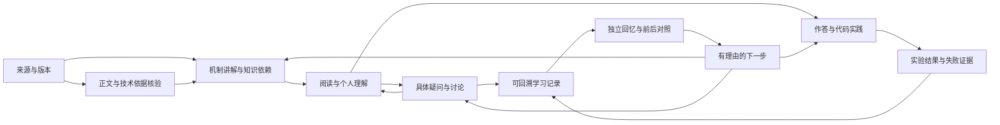

# SuGuilin 学习系统：对象、状态与产品约束

当前架构与本轮改动，2026-10-13。面向有Python/ML/LLM经验、需要长期深化与拓展的个人学习者。系统成果是能持续积累的理解、问题、作答与实践证据；页面数、链接数、阅读次数不认证能力。

## 系统主线

这不是强迫每次学习完成全部步骤。闲暇阅读、只记问题、暂不运行代码、中断复习均可保存并继续。来源未读、问题未解决、实验未执行与学习已掌握不是同一状态。

## 五个协作层

| 层 | 核心职责 | 当前实现与边界 |
| --- | --- | --- |
| 知识与来源 | 原文范围、版本、机制、前置与反例 | 30篇教材、显式前置/相邻关系、原资料及核验说明；资料条目不自动变成完整课程 |
| 个人学习记录 | 收藏、标注、问题、作答、实验、复习尝试 | 原始notes/studyProgress/conversations等对象，按专题ID与可信回链关联；保留历史和独立回忆 |
| 学习调度 | 时间预算、继续何事、推荐理由 | `learningContext`统一读取已有记录；`learningAction`统一延续动作；日队列使用原调度器，推荐使用原信号模型 |
| 阅读与操作 | 内容优先、连续入口、不中断输入 | 计划、推荐与阅读页读取同一专题上下文；记录变化只刷新只读链接，不重建正在输入的作答区域 |
| 持久化与服务 | 本机保存、恢复、导出、权限与模型 | 免费本机记录/JSON/Obsidian；既有Supabase保持部署未开通，官方会员网站通过复制上下文衔接；不宣称站内模型已实时回答 |

知识库、计划、阅读、日志、练习与面试是不同目的的视图。它们共享学习对象和状态，不各自复制一份“学习进度”。派生上下文不落库、不新增掌握度分数，导入旧备份即可重建。

## 统一的专题上下文

一个专题的上下文包括：保存的阅读位置、当前尝试、关联笔记与标注、未解疑问、实验记录、复习日期。严格按专题关联，不能把另一个专题或未关联的个人问题塞入当前课文。无记录时不显示一排0或空提示。

执行顺序：进行中的独立回忆→明确到期复习→待自检作答→关联未解疑问→继续阅读。推荐如果明确说“这个问题还待解答”，则直接打开那个问题的日志；推荐理由和目标必须一致。显式“阅读”“练习”等操作保持用户选择的意图。

已解决问题仍保留原文与讨论，可重新打开；解决后不再占未解疑问推荐。正在“待解答问题”筛选中标解决，去除不再匹配的类型筛选并保留当前笔记，避免操作后看不到自己刚更新的记录。计划中当前主动作已覆盖的任务，不在待处理列表重复出现。

记录变化时，阅读页显示关联日志、未解疑问、当前/上次作答、实验草稿/记录和复习日期；不是额外的大面板。当前回忆与旧答案分开计数，导入实验结果不代替作答或自评。

## 知识如何进入体系

来源→保留作者/时间/版本/读取范围→核对技术依据与观点条件→形成机制讲解/具体问题→原创练习与可执行实验→进入明确知识依赖→个人记录与复习。未取得正文的公众号/小红书等保留线索状态，不生成“已读要点”；最新发布日期、作者发布日期、核对日期、运行环境分别记录。

已有阅读、标注、练习、问题和报告仍是原数据；本轮没有修改共享状态格式、数据库、来源提炼器或推荐评分规则。知识深度、真实模型/GPU/服务实践、跨天学习效果仍按原文和实际实验验收，不能由统一导航推出已经完成。

## 参考模式与采用范围

- [Readwise标注与笔记](https://docs.readwise.io/reader/docs/faqs/highlights-tags-notes)：读官方公开说明，参考记录附原文、聚合后能回原上下文；不复制资产，也未体验付费账户。
- [Obsidian内部链接](https://help.obsidian.md/links)：官方入口，参考持久记录之间的可回溯连接；不将外部产品的同步能力当本站已启用。
- [Anki FSRS文档](https://docs.ankiweb.net/manual/deck-options)：读当前官方调度说明入口。本站仍使用明确的自评日期与独立尝试，不声称实现或验证了FSRS、记忆概率或最优学习效果。

## 本轮验收门槛

1. 同一专题的推荐、计划、阅读和日志能指向同一问题/作答/实验。
2. 推荐“未解疑问”确实打开原问题，不掉回普通正文；外专题问题不被错误关联。
3. 新复习只统计本次空白/已写作答，旧答案和实验仍可对照。
4. 更新上下文不覆盖作答输入、不清空光标、不修改原记录。
5. 问题解决后仍能回看、重新打开，当前筛选不会使它凭空消失。
6. JSON恢复后上下文一致，读取投影不改变备份；没有由阅读或收藏推算掌握度。

实现证据：纯状态、备份重建、跨页同一身份、推荐理由/目标、外专题隔离与复习优先级回归。最终线上真实操作结果按实测补记。

## 线上操作追查

首版6826ded已成功发布。实际保存一个同专题问题后，阅读页即时显示1篇记录/1个未解疑问；首页理由“你留下的问题还待解答”对应链接准确进入原问题日志，计划也保留同一问题身份。手机从“未解疑问”筛选进入后标解决，当前笔记继续可见，可重新打开，页面无横向溢出。

作答后当前输入仍保持焦点与原值，上下文更新为本次作答1/2。用前轮已实际运行的数学报告验证关联：导入时显示实验草稿，保存到日志后显示实验记录；不冒充本轮模型/GPU实跑。进一步补上从旧问题继续讨论时的当前同专题作答、实验观察和最近实验回链；原问题不改写，外专题与旧回忆作答不混入。只读上下文增高时保留阅读锚点，避免输入区域跳动。

继续原问题的待复制文本包含当前作答、数学报告观察、一手来源和原问题/实验的准确日志回链；没有向外部模型发送。自评后实际开启独立回忆，两道作答及笔记均为空，旧记录可回查；复习页也接入同一只读上下文，回归约束保证不把上次作答当本次成果。

15个全站入口分别在1280×900浅色与390×844深色环境加载，30次页面检查均未横向溢出。这是布局与入口检查，不代表每项服务、每篇课程内容或跨天效果都已全面认证。104项代码回归全部通过，包含当前尝试、旧记录隔离、备份重建和时区边界。

验收只新增自己的一个专题安排和三篇记录，结束后通过可恢复的操作清理，并保留专题备份。再次导出的完整JSON与验收前逐字段完全一致：原有18篇记录、4个学习安排及全部其他字段保留；没有用覆盖整份备份的方式清空用户记录。

## 2026-10-15：让实际学习结果影响下一步

本轮在独立的 localhost 来源从空记录验收，线上原有18篇记录、4个安排未写入或替换。先备份线上数据，再从每日计划选择 RAG，阅读、收藏、标注，完成四题、实际运行并下载代码、导入失败报告、保存问题/观察、修正重跑、自评、日志回看及同日独立回忆。新回忆四题均为空，原答案可按需展开；这是功能验收，不是跨天记忆效果认证。模型服务未调用，既有后端和共享格式未修改。

### 发现的系统问题与修复

| 问题 | 改动和验收依据 |
| --- | --- |
| RAG 的实际索引行为仅由给定排序列表代替 | 新增无密钥 SQLite FTS5 教学实验，真的建库、检索、过滤、更新、删除和重开；保留原数学 notebook |
| 失败报告写进笔记，计划与推荐不知道该继续做什么 | 从支持的完整检查表派生待复核项；进入实验/提问，保留当前答案和观察；不建立能力分数 |
| 通过后再导入曾出现过的失败报告被当成重复 | 仅与同一实验最后一份报告去重；通过→再次失败能如实记录，旧报告保留 |
| 自评后的推荐只有关键词延伸 | 使用显式前置与相邻知识关系；按需补读或深化，既有计划优先，不自动认定前置知识已掌握 |
| 首页相邻推荐与每日计划选择不同 | 两者使用同一推荐依据，按当天剩余时间给建议；不额外创建学习安排 |
| 四级小标题显示成带井号的普通段落 | 支持深层 Markdown 标题，课文语义层级与紧凑字号统一；chapter-N 意义不变 |
| 回看日志要先翻完重复的检查列表 | 完整生成的检查表可折叠，自己的作答/解释直接可读；编辑、提问与导出保留原文，代码围栏不折叠 |

实验待复核是原记录的只读投影。支持的 notebook 与实验身份从同一目录取得；只读取完整、关联本专题的已知检查项。当前尝试优先，同一尝试采用最后一份完整报告；没有当前报告时回查该专题最近保存的实验记录。普通散文、别的专题和旧作答对照不会被当成新失败。通过检查不自动解决疑问，学习者仍决定是否标记问题解决。

### 调研与实跑边界

- [SQLite FTS5](https://www.sqlite.org/fts5.html)：读取 BM25 排序、Unicode61 与索引一致性相关官方段落。实际运行环境 SQLite 3.51.0，英文原创教学语料；不宣称中文分词、向量召回或统计侧信道隔离已经实现。
- [Qdrant filtering](https://qdrant.tech/documentation/search/filtering/)、[Hybrid Queries](https://qdrant.tech/documentation/search/hybrid-queries/)：核对过滤、Weighted RRF 的 v1.17.0 标注、融合与归一化前提；未运行 Qdrant。机制核对时间与实际软件实验版本分别说明。
- [Datawhale All-in-RAG](https://github.com/datawhalechina/all-in-rag)、[分块原文](https://github.com/datawhalechina/all-in-rag/blob/main/docs/chapter2/05_text_chunking.md)：重读前置/目录及分块相关段落；示例参数与注释差异仍保留核验说明，未运行整库。
- [zone7 的中文原作者实践](https://www.cnblogs.com/zone7/p/19729698)：读混合检索策略和示例；将固定权重与“最优”判断转成分数量纲、协议与评测条件的阅读问题，关联课文，不当成本站成绩。
- 知乎、微信公众号、小红书发现检索已执行；知乎目标正文返回错误，微信/XHS 未取得可确认的原帖正文，不伪写博主要点或冒称大厂真题。社区观点、官方机制与本站实验保持不同证据范围。

同一下载 notebook 的两种实现均实际执行：先截断再过滤时，Alice 的证据 Recall@2=0.5，修正后为1；失败版两项未通过，修正版九项通过。正文和面试 q7/q8 补充这一因果对照、更新/删除、引用版本与语义支持的区别。教学比例不外推到真实模型、语料或产品收益。

本地真实浏览器完成30篇阅读页与15个入口在1280×900浅色、390×844深色的90项加载/排版检查，未发现横向溢出或残留井号标题；正文16px，深层标题16px/24.8px。布局检查不等于把所有课程重新全文复现。110项回归包含报告再次失败、导入兼容、同专题隔离、前置/相邻推荐、计划剩余预算、标题语义、日志折叠及原文保留。自评30分钟后，计划按剩余15分钟推荐上下文工程，与首页的知识关系一致。

手机日志回看另发现正文仍为18px/30.6px、题目小标题19px，已改为正文16px/26.4px、小标题16px/24.8px，编辑框同步16px。保持可读宽度和原始内容，减少字体跳变与单屏低信息量。
